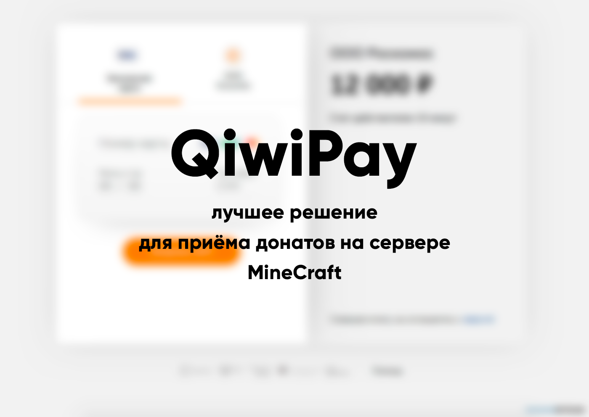
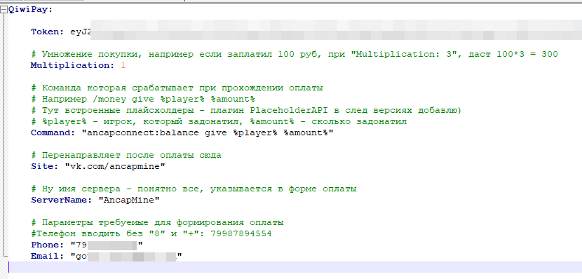

# Эстонская разведка сообщает: Qiwi больше нет. 
# Если спустя два года хочется обсудить этот вопрос (в т.ч. вопрос замены): https://discord.gg/hkqzkRfGxc либо @pukpukov в дискорде/телеграме

Плагин для MineCraft, позволяющий проводить платежи через QIWI p2p API.

### Возможности

- Приём платежей через p2p QIWI API (оплата с киви-кошельков и банковских карт);
- Система промокодов на фиксированные суммы и на процент к пополнению

### Преимущества

 

- Отсутствие каких-либо комиссий на переводы;
- Интернационализация;
- Асинхронность;
- Чистый и расширяемый код (качество кода 100% согласно codefactor.io, уровень поддерживаемости - 100% согласно CodeClimate)
- Проект полностью OpenSource (лицензия MIT)

# QiwiPay

 

  

### Настройка плагина

Чтобы плагин работал, необходимо ввести секретный ключ от p2p qiwi api в config.yml. Получить его можно тут: https://p2p.qiwi.com/.
Также надо заполнить все позиции ниже

### Приём платежей

Для создания счёта об оплате игрок должен ввести /donate <сумма> [промокод]. Когда счёт будет оплачен, в консоль будет выпущена команда, указанная в конфигурации, с суммой, которую заплатил игрок.

### Промокоды

В плагине можно создавать промокоды на пополнение и на фиксированные выплаты.

#### Создание

/promo create fixed <sum> <количество_использований> <срок_действия в днях> - создать промокод с фиксированным вознаграждением

/promo create bonus <bonus> <количествово использований> <срок действия в днях> - создать промокод с бонусом на пополнение (бонус указывается в процентах, он добавляется к сумме пополнения, например бонус 50 даст 5 рублей к пополнению в 10 рублей). Обратите внимание, что все промокоды поднимаются в верхний регистр, то есть nEwYear2022 превратится в NEWYEAR2022

#### Использование

Игроки могут использовать промокоды с фиксированным вознаграждением командой /promo use <название>.

Для того, чтобы получить бонус к пополнению, надо в команде /donate <сумма>  в конце ещё дописать промокод, например /donate 50 NEWYEAR2022
  
### Внутренний баланс и товары

- /wallet - посмотреть свой баланс
- /reward <ник> <сумма> - пополнить баланс игрока
- /buy <донат> - купить донат
  
Конфиг интуитивно понятный.
  
## Самостоятельная сборка
Скачайте zip архив проекта и выполните install.bat/mvn clean install.
